# 임베디드 · 보드타는 사람들

2026 광운대학교 매치업 심화과정 「임베디드 보드를 활용한 인공지능 시스템 최적화 실무」
Raspberry Pi 5 한 대로 트랙을 스스로 달리고, 표지판과 신호를 지키는 자율주행 차 프로젝트입니다.

- **팀:** 조성호(팀장) · 이지우 · 하서현 · 강준모
- **지도교수:** 이예솝

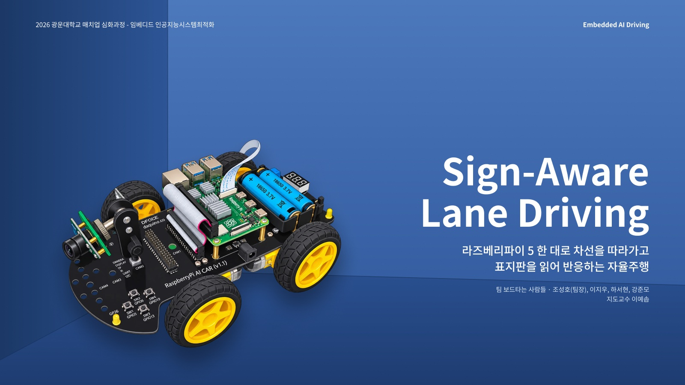

## 한눈에 보기

| 영역 | 방법 | 결과 |
|---|---|---|
| 차선 | LAB 색공간에서 초록 경계 마스크 → 띠 3줄로 도로 중앙 계산 → 상태 판정 → P 제어 | 시뮬레이터 60초 주행, 도로 위 100% |
| 표지판 | YOLOv8n 10종 → TFLite INT8 | INT8 mAP50 0.957, 크기 3.25 MB |
| 주행 | 상태 머신 + 표지판 동작(정지 · 신호 · 서행 · 회전 · 도착) | 교차로 좌 · 우 · 직진 3/3, 테스트 17/17 |

차에 바로 올려 보려면 [라즈베리파이에서 실행하기](#라즈베리파이에서-실행하기)를 따라 하면 됩니다.

## 발표 자료

### 01 미션
트랙을 완주하면서 표지판과 신호를 지켜야 합니다.

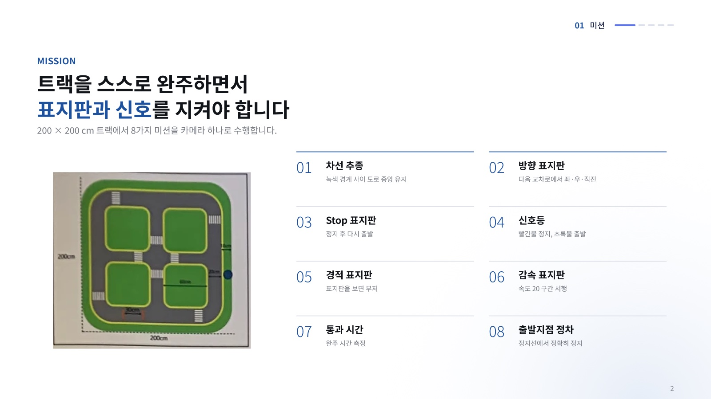

차선을 따라 트랙을 돌고, 교차로에서는 방향 표지판대로 회전합니다. 정지 표지판, 신호등, 속도 제한, 경적 표지판에 맞춰 움직이고, 도착 정지선에서 멈춥니다.

### 02 기기
라즈베리파이 5, 카메라, 좌우 바퀴 차동 구동(TB6612), 18650 배터리 2개로 구성했습니다. 카메라 입력부터 판단, 모터 제어까지 한 보드에서 처리합니다.

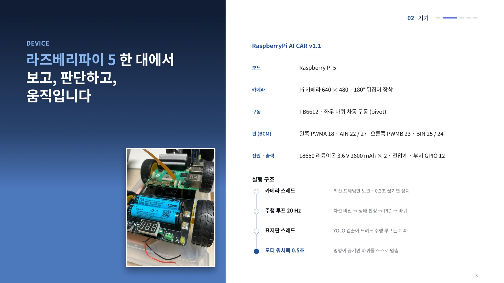

- 카메라가 거꾸로 달려 있어 영상을 180° 뒤집어 씁니다.
- 조향 장치 없이 좌우 바퀴 속도 차이로 방향을 바꿉니다.
- 0.5초 동안 명령이 없으면 바퀴를 스스로 멈춥니다(워치독).

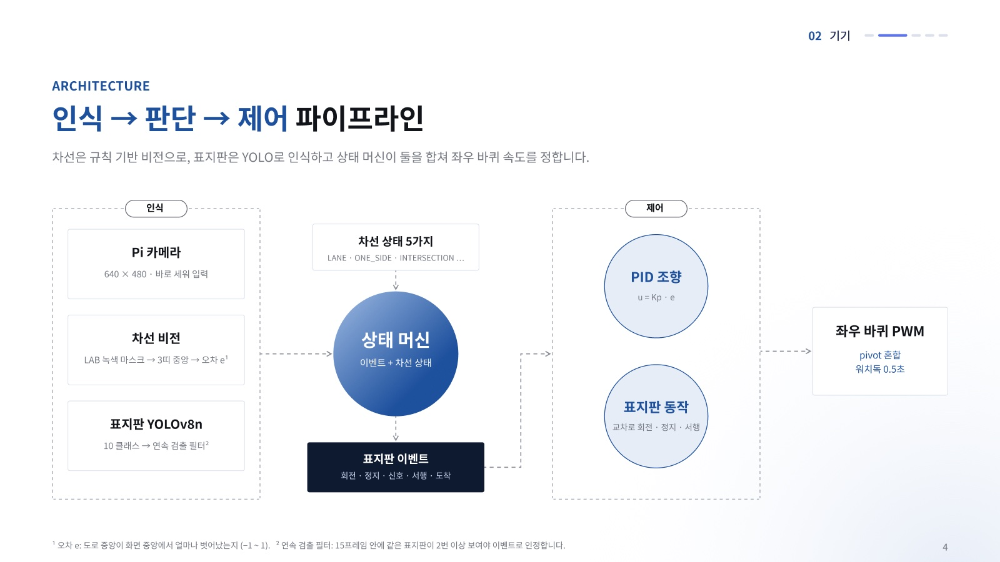

카메라 한 대의 영상이 두 갈래로 나뉩니다.
- **차선 비전:** 도로 중앙이 화면 중앙에서 얼마나 벗어났는지(오차 e)를 계산합니다.
- **표지판 YOLO:** 표지판 이벤트를 만듭니다.
- **상태 머신:** 두 결과를 합쳐 좌우 바퀴 세기를 정합니다. 표지판 검출은 별도 스레드에서 돌아서, 검출이 느려도 주행 루프는 멈추지 않습니다.

### 03 전처리
- **차선:** 카메라 영상에서 초록 경계만 남기고, 가로 띠 3줄에서 양쪽 경계를 찾아 도로 중앙을 계산합니다.
- **표지판 데이터:** 학습 전에 데이터 문제 세 가지(라벨 누락, 연속 프레임 섞임, right 부족)를 고쳤습니다.

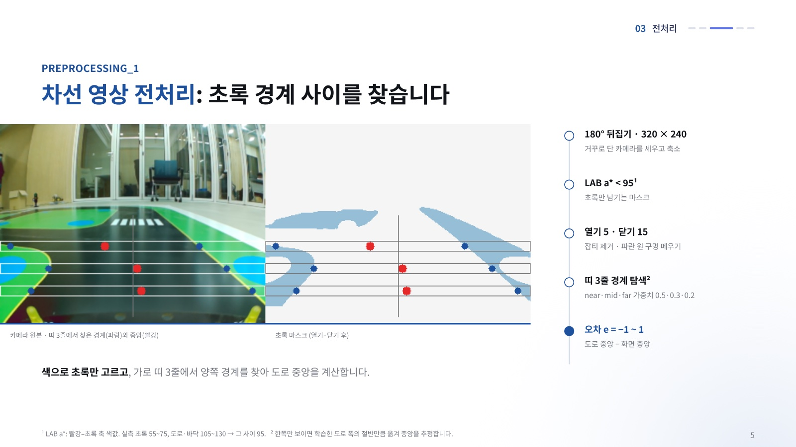

- **초록 경계 찾기:** a*는 색이 얼마나 초록/빨강에 가까운지 나타내는 값입니다. 실측 초록 55~75, 도로 105~130이라 그 사이인 95보다 작은 픽셀(초록)만 남깁니다.
- **잡티 정리:** 열기·닫기 연산으로 작은 잡티를 지웁니다.
- **도로 중앙 계산:** 가까운·중간·먼 띠 3줄에서 양쪽 경계를 찾고, 가중치 0.5·0.3·0.2로 평균해 도로 중앙을 정합니다.
- **한쪽만 보일 때:** 띠마다 기억해 둔 평소 도로 폭으로 반대쪽 경계를 추정합니다.

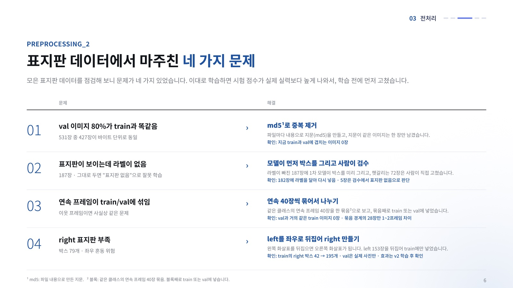

| 문제 | 해결 | 확인 결과 |
|---|---|---|
| 1. 표지판이 보이는데 라벨이 없는 이미지 187장 | 1차 모델이 박스를 미리 그리고, 헷갈리는 72장은 사람이 검수 | 182장에 라벨을 달아 다시 넣었고, 5장은 표지판 없음으로 판단 |
| 2. 이웃 프레임이 train과 val에 섞임 | 같은 클래스의 연속 40장을 한 묶음으로 보고, 묶음째 나눔 | val과 거의 같은 train 이미지 0장 |
| 3. right 표지판이 적음 | left 153장을 좌우로 뒤집어 right로 합성(train에만) | train의 right 박스 42 → 195개, val은 실제 사진만 사용 |

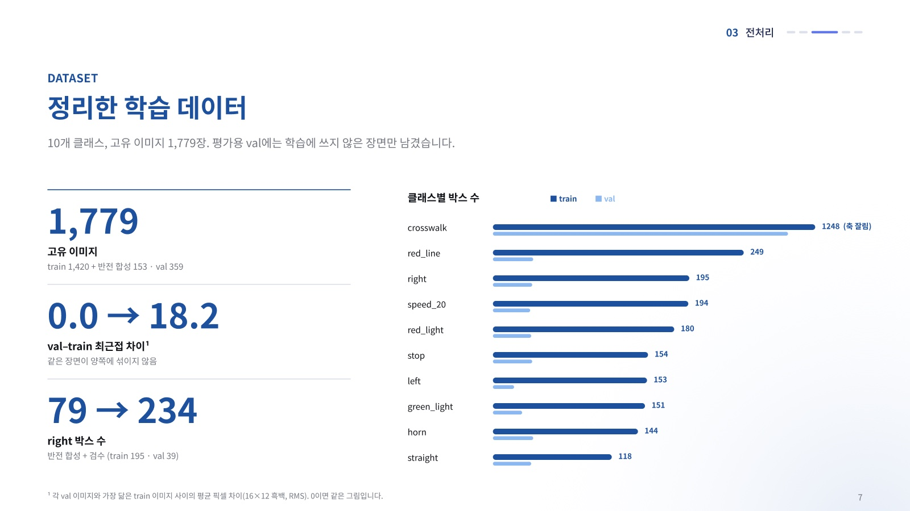

정리한 데이터셋은 10개 클래스, 고유 이미지 1,779장입니다(train 1,420 + 반전 합성 153, val 359).
- **"val–train 최근접 차이":** 각 val 이미지와 가장 닮은 train 이미지 사이의 픽셀 차이입니다. 0이면 같은 그림이라는 뜻이고, 정리 후 18.2로 커졌습니다.
- **횡단보도 박스가 가장 많은 이유:** 한 장에 여러 개가 찍히는 경우가 많아서입니다.

**표지판 데이터 수집:** 주행할 때와 같은 카메라 노출 설정으로 표지판마다 촬영했습니다(`sign/capture.py`, 초당 3장).
- **라벨 형식:** 파일 이름에 클래스를 기록합니다(`stop_0042.jpg` = 정지).
- **장면 분리:** 장면을 바꿀 때 번호를 40씩 건너뛰어, 이웃 프레임이 학습·검증에 섞이지 않게 합니다.
- **실차 배경:** 표지판이 없는 실차 주행 프레임 151장을 "표지판 없음"으로 추가해 오검출을 줄였습니다.

labelImg로 10개 클래스에 박스를 그렸습니다. 라벨링 규칙은 다음과 같습니다.
1. 표지판과 신호등은 기둥을 빼고 판 부분만 박스로 표시합니다.
2. 기호 전체를 박스에 넣고, 한 이미지에 여러 개가 있으면 모두 표시합니다.
3. 너무 멀리 있는 횡단보도는 라벨링하지 않습니다.
4. 정지선은 선 하나당 박스 하나로 표시합니다.

- **모델과 입력:** YOLOv8n을 640 입력으로 학습했습니다.
- **좌우 반전 증강은 쓰지 않음:** 좌우가 바뀌면 left와 right의 의미가 뒤바뀌기 때문입니다.
- **모자이크 증강:** 사진 4장을 이어 붙여 한 장으로 학습하는 방식입니다.
- **학습 곡선:** 기준선 모델은 25 epoch에서 val 점수가 가장 높았습니다.

### 04 알고리즘
차선 상태를 판정하고, 표지판을 보면 정해진 동작을 합니다. 교차로 회전은 직진 → 회전 → 차선 다시 잡기 순서로, 시간을 기준으로 합니다.

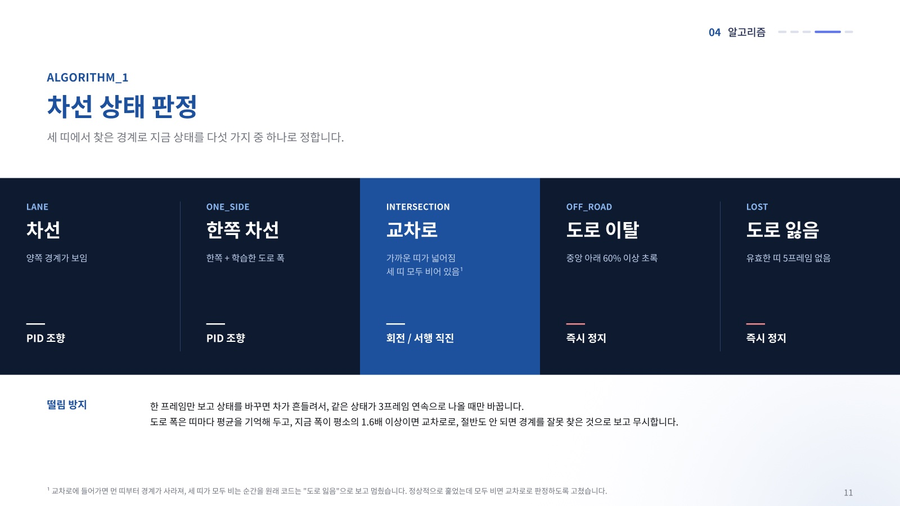

- **5가지 상태:** 띠 3줄에서 찾은 경계로 지금 상태를 정합니다. 차선, 한쪽 차선, 교차로이면 계속 달리고, 도로 이탈이나 도로 잃음이면 바로 멈춥니다.
- **흔들림 방지:** 같은 상태가 3프레임 연속으로 나와야 상태를 바꿉니다.
- **고친 버그:** 원래 코드는 교차로에 들어가 띠가 모두 비는 순간을 "도로 잃음"으로 보고 멈췄습니다. 지금은 교차로로 판정합니다.

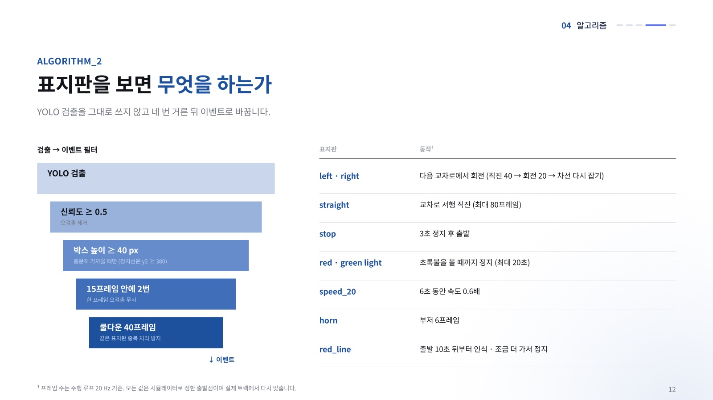

YOLO가 한 번 검출했다고 바로 움직이지 않습니다. 아래 네 단계 필터를 모두 통과해야 동작합니다.
1. 신뢰도 0.5 이상
2. 박스 높이 40 px 이상, 즉 충분히 가까울 때
3. 15프레임 안에 2번 이상 검출
4. 같은 표지판은 40프레임 동안 다시 처리하지 않음

프레임 수는 주행 루프 20 Hz 기준입니다(20프레임 = 1초).

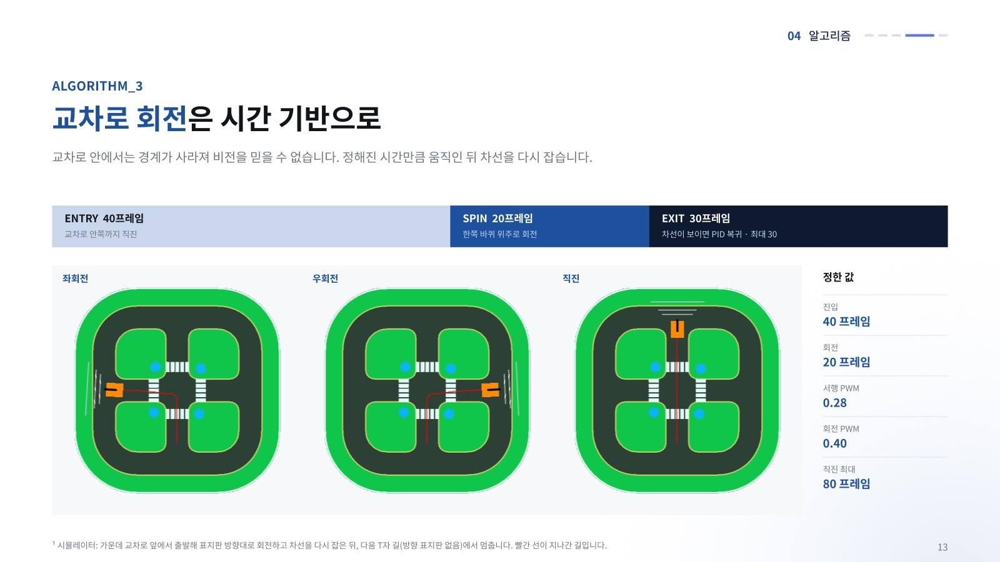

교차로 안에서는 경계가 사라져 비전을 믿을 수 없습니다. 그래서 정해진 시간만큼 움직입니다.
1. 직진 40프레임(2초)
2. 한쪽 바퀴 위주로 회전 20프레임(1초)
3. 차선이 보이면 다시 PID 조향으로 복귀(최대 30프레임)

그림의 빨간 선은 시뮬레이터에서 차가 지나간 길입니다. 모든 값은 출발점일 뿐이고, 실제 트랙에서 다시 맞춰야 합니다.

### 05 성능

용어 설명:
- **mAP50:** 표지판을 찾고 종류까지 맞혔는지를 0~1로 매긴 점수입니다. 박스가 정답과 절반 이상 겹치면 맞힌 것으로 보고, 1에 가까울수록 놓치거나 헛것을 보는 일이 적습니다.
- **mAP50-95:** 박스 위치까지 더 엄격하게 채점한 점수입니다.
- **Precision:** 찾았다고 한 것 중 진짜 표지판의 비율입니다.
- **Recall:** 실제 표지판 중 찾아낸 비율입니다.

기준선 모델(데이터 검수 전, 25 epoch)의 점수입니다. 학습에 쓰지 않은 장면 338장에서 mAP50 0.973을 기록했습니다.

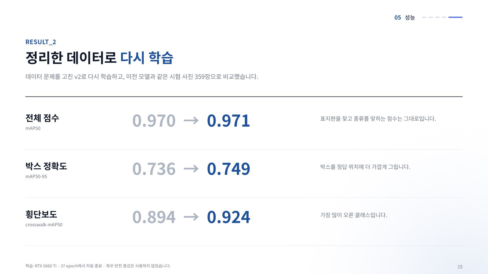

데이터 문제를 고친 v2로 다시 학습했습니다. 같은 val 359장에서 기준선과 비교한 결과입니다.
- 전체 점수는 거의 같습니다.
- 박스 정확도는 0.736에서 0.749로 올랐습니다.
- 횡단보도는 0.894에서 0.924로 가장 많이 올랐습니다.

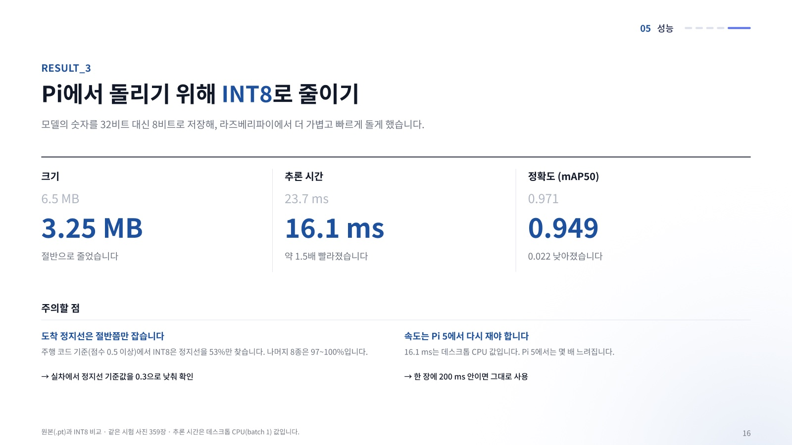

라즈베리파이에서 빠르게 돌도록 모델 숫자를 32비트 대신 8비트로 저장했습니다(TFLite INT8).

| 모델 | 크기 | mAP50 | 추론 시간 (데스크톱 CPU) |
|---|---|---|---|
| 원본 `.pt` | 6.51 MB | 0.971 | 23.7 ms |
| **INT8 `.tflite`** | **3.25 MB** | **0.949** | **16.1 ms** |

- **약한 클래스:** 도착 정지선(red_line)은 주행 코드 기준(점수 0.5 이상)에서 53%만 잡습니다.
- **Pi 5 속도:** 추론 시간은 데스크톱 CPU 값입니다. Pi 5에서 다시 재야 합니다.
- 자세한 결과는 [docs/sign-v2-int8.md](docs/sign-v2-int8.md)에 있습니다.


v2 INT8이 도착 정지선을 절반쯤 놓쳐서, Pi 없이 할 수 있는 개선 네 가지를 해 봤습니다. 모두 같은 시험 사진 359장으로 비교했습니다.

| 실험 | 왜 | 어떻게 |
|---|---|---|
| 실차 카메라 배경 추가 | 실차 카메라는 도로가 어둡고 의자·문틀이 보여 오검출 위험 | 표지판 없는 실차 프레임 151장을 "표지판 없음" 사진으로 학습에 추가 |
| 정지선 집중 학습 | v2 INT8 정지선 재현율 53% | 정지선 사진 191장을 학습 목록에 3번씩 넣고, 밝기 증강을 키움(0.4 → 0.6) |
| YOLO 버전 비교 | 최신 모델이 더 정확할 수 있음 | 같은 데이터로 YOLOv8n · YOLO11n · YOLO26n 학습 후 INT8로 바꿔 비교 |
| 입력 크기 320 | Pi가 느릴 때 쓸 대안 | 640 대신 320 입력으로 학습해 속도·정확도 비교 |

학습에 쓰지 않은 실차 카메라 사진 344장으로, 없는 표지판을 잘못 잡는지(오검출)도 검사했습니다.

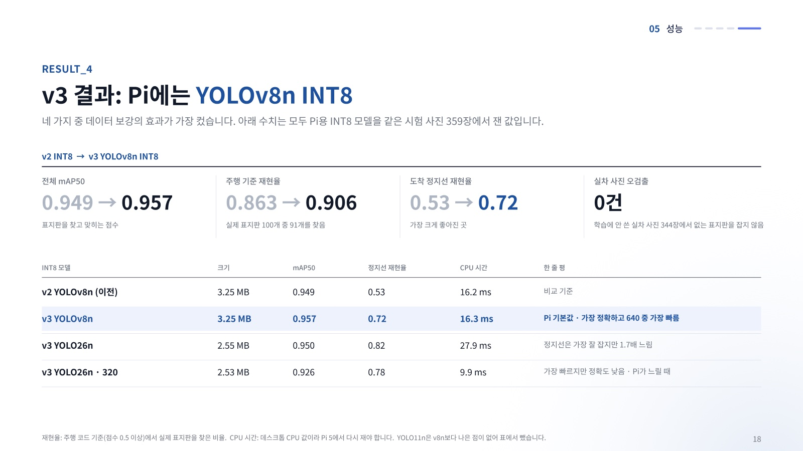

네 가지 중 **데이터 보강(실차 배경 + 정지선)의 효과가 가장 컸습니다.** Pi에는 v3 YOLOv8n INT8을 씁니다.

| INT8 모델 | 크기 | mAP50 | 정지선 재현율 | CPU 시간 | 평가 |
|---|---|---|---|---|---|
| v2 YOLOv8n (이전) | 3.25 MB | 0.949 | 0.53 | 16.2 ms | 비교 기준 |
| **v3 YOLOv8n** | **3.25 MB** | **0.957** | **0.72** | **16.3 ms** | **Pi 기본값** · 가장 정확하고 640 중 가장 빠름 |
| v3 YOLO26n | 2.55 MB | 0.950 | 0.82 | 27.9 ms | 정지선은 가장 잘 잡지만 1.7배 느림 |
| v3 YOLO26n · 320 | 2.53 MB | 0.926 | 0.78 | 9.9 ms | 가장 빠르지만 정확도 낮음 · Pi가 느릴 때 |

- **주행 기준 재현율:** 0.863에서 0.906으로 올랐습니다(점수 0.5 이상에서 실제 표지판을 찾은 비율).
- **실차 오검출:** 실차 사진 344장에서 모든 모델이 0건이었습니다. 이 사진에는 표지판이 없어서, 실차에서 표지판을 잘 잡는지는 아직 확인해야 합니다.
- **YOLO26n:** 원본(PyTorch)에서는 가장 정확했지만(mAP50 0.983), INT8로 바꾸면 손실이 크고 느렸습니다.
- **YOLO11n:** v8n보다 나은 점이 없었습니다.
- **CPU 시간:** 데스크톱 CPU 값입니다.
- 자세한 결과는 [docs/sign-v3.md](docs/sign-v3.md)에 있습니다.

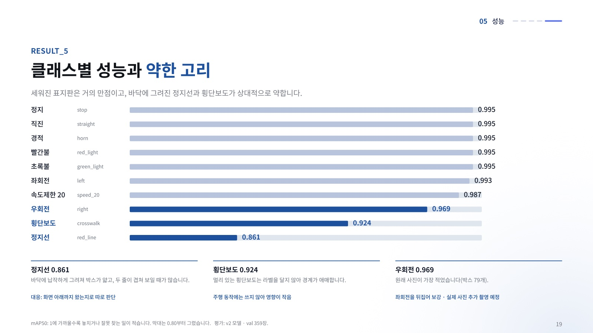

v2 모델의 클래스별 mAP50입니다. 막대는 0.80부터 그렸습니다.
- 세워진 표지판 7종은 0.99 수준입니다.
- 바닥에 그려진 정지선(0.861)과 횡단보도(0.924)는 약합니다.
  - 정지선은 박스가 얇고 두 줄이 겹쳐 보이는 경우가 많습니다. 그래서 "화면 아래까지 왔는지"로 따로 판단합니다.

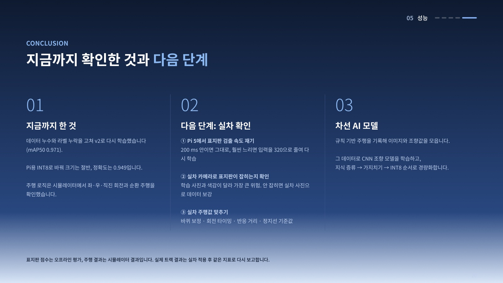

차와 Pi 없이 노트북에서 주행 코드를 시험하려고 파이썬으로 직접 만든 2D 시뮬레이터입니다(`drive/sim.py`).
- **가상 카메라:** 실제 주행 사진과 도로 폭, 색이 같아 보이도록 맞췄습니다.
- **반복:** 1초에 20번, 화면 만들기 → 팀 주행 코드 판단 → 바퀴 세기대로 이동 → 기록을 반복합니다.
- **한계:** 표지판 인식(YOLO)은 들어 있지 않고, 트랙 크기와 모터 특성은 추정값입니다.

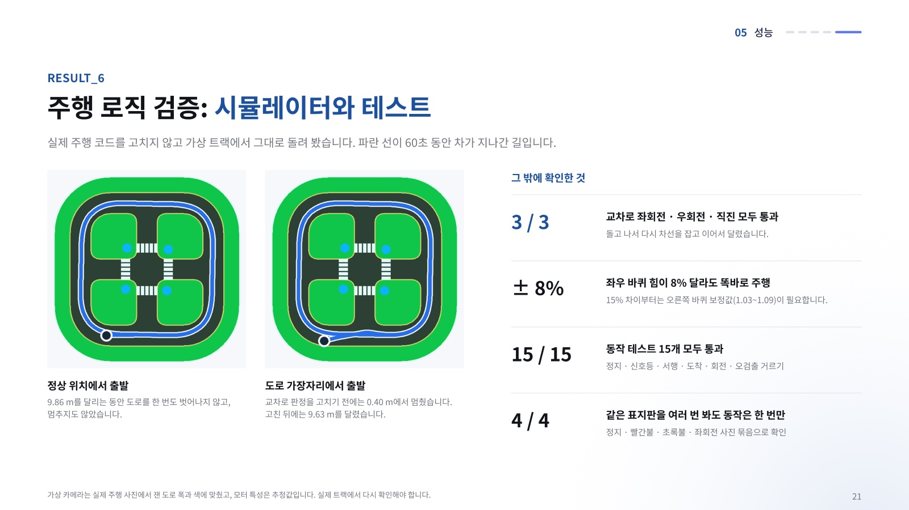

- **파란 선:** 60초 동안 차가 지나간 길입니다.
  - 정상 위치에서 출발하면 9.86 m를 달리는 동안 도로를 벗어나지 않았습니다.
  - 도로 가장자리에서 출발하면, 교차로 판정을 고치기 전에는 0.40 m에서 멈췄고 고친 뒤에는 9.63 m를 달렸습니다.
- **그 밖에 확인한 것:**
  - 교차로 좌회전·우회전·직진 3/3 통과
  - 좌우 바퀴 힘이 8% 달라도 직진
  - 동작 테스트 15/15 통과

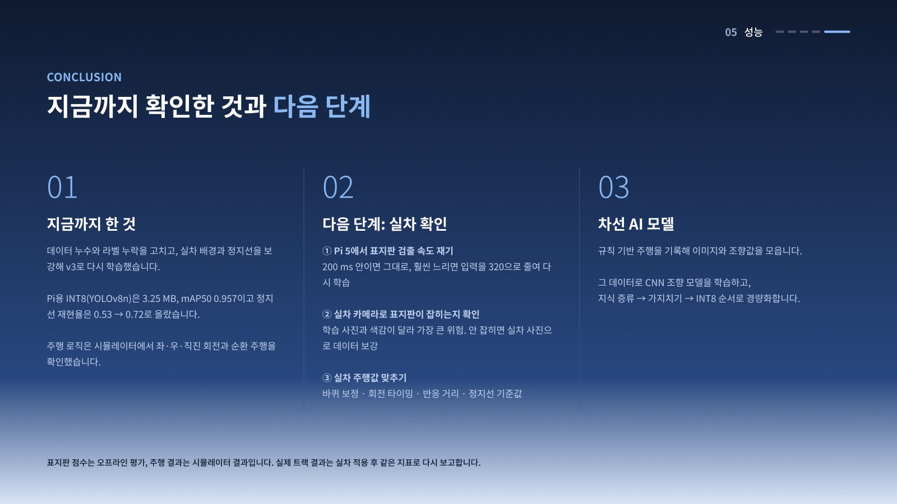

**다음 단계**
1. Pi 5에서 표지판 검출 속도를 잽니다.
2. 실제 차 카메라로 표지판이 잡히는지 확인합니다.
3. 바퀴 보정, 회전 타이밍, 반응 거리, 정지선 기준값을 실차에 맞춥니다.

그 뒤에는 주행 기록으로 차선 CNN 조향 모델을 학습하고, 지식 증류 → 가지치기 → INT8 순서로 경량화합니다.

## 라즈베리파이에서 실행하기

학습한 표지판 모델은 `weights/sign_v3_8n_int8.tflite` 에 들어 있습니다. 아래 순서대로 하면 차에서 바로 확인할 수 있습니다.

### 1. 설치 (처음 한 번)

Pi 5 (64-bit Raspberry Pi OS) 에서 실행합니다.

```bash
git clone https://github.com/dlwldn4824/Embedded_BoardRiders.git 임베디드
cd 임베디드
python3 -m venv --system-site-packages .venv
source .venv/bin/activate
pip install ultralytics ai-edge-litert simple-pid gpiozero opencv-python pyyaml
```

- 카메라 라이브러리(picamera2)는 Pi OS 에 기본으로 들어 있습니다. 그래서 가상환경을 만들 때 `--system-site-packages` 를 꼭 붙입니다.
- 이미 받아 둔 경우에는 `git pull` 만 하면 됩니다.

### 2. 속도 확인

```bash
python3 sign/pi_bench.py weights/sign_v3_8n_int8.tflite weights/sign_v3_26n_320_int8.tflite
```

- 표지판 검출 한 번이 **300ms 이하**여야 합니다. 시뮬레이터에서 이보다 느리면 초록불과 도착선을 놓쳤습니다.
- 640 모델이 느림으로 나오면 320 모델을 씁니다. 이때 `drive/config.py` 의 `SIGN_IMGSZ` 를 `320` 으로 바꿉니다.

### 3. 표지판 인식 확인 (모터는 움직이지 않습니다)

```bash
python3 -m drive.sign_check --signs weights/sign_v3_8n_int8.tflite
```

- 차 앞에 표지판을 하나씩 두고 천천히 가까이 가져옵니다.
- 화면에 `*** EVENT` 가 나오면 주행 중에 그 표지판에 반응한다는 뜻입니다. 이때 표지판까지의 거리를 적어 둡니다.
- 검출은 되지만 반응하지 않으면 줄 끝에 이유가 나옵니다. 예를 들어 `멀다 (박스 <40px)` 는 아직 멀다는 뜻입니다.
- 빨간불은 멀리서 보면 기억만 하고, 횡단보도가 차 바로 앞에 왔을 때(`crosswalk` 의 `EVENT`, 상자 아래 끝 y2 ≥ 350) 섭니다. 차를 서고 싶은 자리에 두고 `crosswalk` 줄의 y2 를 적어 둡니다.
- Ctrl+C 로 끝내면 `logs/sign_check_<시각>/` 에 결과가 저장됩니다.
  - `det/`: 검출 박스를 그린 사진입니다. 초록 박스는 반응하는 검출, 주황 박스는 무시하는 검출입니다.
  - `raw/`: 원본 사진입니다. 놓친 표지판을 라벨링해서 다시 학습할 때 씁니다.
  - `summary.txt`: 검출 시간과 클래스별 최대 박스 크기를 정리한 파일입니다.

### 4. 주행

먼저 바퀴를 바닥에서 띄우고 표지판을 보여 주면서 바퀴가 맞게 반응하는지 봅니다. 그다음 트랙에 내려놓고 달립니다.

```bash
python3 -m drive.main --mode real --signs weights/sign_v3_8n_int8.tflite
```

`s` 로 출발하고, 스페이스바(또는 아래 방향키)로 비상 정지하고, `q` 로 끝냅니다. 키를 받는 창이 떠야 하므로 Pi 에 모니터를 연결하거나 VNC 로 접속해서 실행합니다.

#### 전력을 아끼는 실행 (보조배터리가 없을 때)

경량화로 기본값에 들어간 것: 카메라 320x240 촬영(`CAMERA_CAPTURE_SIZE`), YOLO 320 입력, 1코어·0.35초 간격, 회전 중 YOLO 쉬기(`SIGN_PAUSE_IN_TURN`).
주행 전에 CPU 최고 클럭도 낮춥니다 (재부팅하면 원래대로):
```bash
bash deploy/low_power.sh
```

기본값을 전력 절약 쪽으로 바꿔 두었습니다: `BASE_THROTTLE = 0.3`, `SIGN_DETECT_INTERVAL_S = 0.35`, `SIGN_CPU_CORES = (0,)`.
화면도 작게 띄웁니다. 카메라 영상 대신 상태 글자만 1초에 2번 갱신하고, `s`·스페이스·`q` 키는 그대로 씁니다.

```bash
python3 -m drive.main --mode real --lite-gui --signs weights/sign_v3_26n_320_int8.tflite
```

CPU 최고 속도를 낮추면 순간 전력이 더 줄어듭니다 (한 번만, 재부팅 후 적용).
```bash
echo "arm_freq=1800" | sudo tee -a /boot/firmware/config.txt
sudo reboot
```

꺼지는 순간의 전압을 남기려면 주행 전에 다른 터미널에서 아래를 켜 둡니다. 다시 켠 뒤 `power.log` 마지막 줄을 봅니다.
```bash
while true; do echo "$(date +%T) $(vcgencmd get_throttled) $(vcgencmd pmic_read_adc EXT5V_V)" >> ~/power.log; sync; sleep 0.5; done
```

#### 주행을 시작하자마자 Pi 가 꺼질 때

YOLO 와 모터가 동시에 전력을 끌어 배터리 전압이 순간적으로 떨어지는 경우입니다(저전압 리셋). 아래 순서로 확인합니다.

1. 다시 켠 뒤 저전압 기록을 봅니다. `0x0` 이 아니거나 `Undervoltage` 가 보이면 전원 부족입니다.
   ```bash
   vcgencmd get_throttled
   journalctl -b -1 | grep -i -E "voltage|throttl"
   ```
2. 바퀴를 띄운 채 같은 명령을 돌려 봅니다. 그래도 꺼지면 YOLO 부하, 안 꺼지면 모터 출발 전류가 원인입니다.
3. 배터리를 완충하고, 그래도 꺼지면 아래 값을 조절합니다 (`drive/config.py`).

| 값 | 기본 | 하는 일 |
|---|---|---|
| `SIGN_USE_PROCESS` | True | YOLO 를 별도 프로세스에서 돌립니다. 주행 루프가 느려져 회전이 늦어지는 것을 막습니다 |
| `SIGN_DETECT_INTERVAL_S` | 0.25 | YOLO 를 1초에 최대 4번만 돌립니다. 0.35 까지 올릴 수 있습니다 (그 이상이면 표지판을 놓칩니다) |
| `SIGN_CPU_CORES` | (0, 1) | YOLO 가 CPU 2코어만 씁니다. `(0,)` 이면 1코어 |
| `MOTOR_RAMP_PER_S` | 1.5 | 출발할 때 바퀴 세기를 약 0.25초에 걸쳐 올립니다. 1.0 으로 낮추면 더 천천히 |
| `SIGN_IMGSZ` + 가중치 | 640 | 가장 가볍게: `weights/sign_v3_26n_320_int8.tflite` 와 `SIGN_IMGSZ = 320` |

시작할 때 `표지판 검출기 준비 완료 (… ms)` 가 먼저 출력되고 나서 `s` 로 출발합니다. 터미널에 `[경고] 주행 루프 … Hz` 가 뜨면 루프가 느린 것이고, 교차로 회전 같은 동작이 그 배수만큼 늦어집니다. 그래도 꺼지면 Pi 는 USB-C 보조배터리(5V 3A 이상)로 따로 켜고, 18650 은 모터에만 씁니다 (GND 는 서로 연결).

### 5. 실차에서 맞출 값

모두 `drive/config.py` 에 있습니다. 시뮬레이터 값은 출발점일 뿐입니다.

| 증상 | 바꿀 값 |
|---|---|
| 직진할 때 한쪽으로 휩니다 | `RIGHT_WHEEL_TRIM` |
| 교차로에서 너무 일찍 또는 늦게 돕니다 | `TURN_ENTRY_FRAMES`, `TURN_FRAMES` |
| 표지판에 너무 멀리서 또는 가까이서 반응합니다 | `SIGN_MIN_BOX_H` (3단계에서 적은 박스 크기를 보고 정합니다) |
| 다른 길의 표지판에 반응합니다 | `SIGN_MIN_BOX_H` 를 올립니다 (시뮬레이터에서는 45 가 맞았습니다) |
| 도착 정지선을 놓칩니다 | `SIGN_CLASS_RULES["red_line"]` 의 `min_y2` 를 낮춥니다 |
| 빨간불에 횡단보도 앞이 아니라 너무 일찍 / 늦게 섭니다 | `SIGN_CLASS_RULES["crosswalk"]` 의 `min_y2` (기본 350). 올리면 더 가까이 섭니다. 차체가 화면 아래를 가려 395 를 넘기면 안 됩니다 |
| 빨간불인데 횡단보도를 지나 교차로 입구에서 섭니다 | 횡단보도를 못 잡은 것입니다. 3단계 점검에서 횡단보도 바로 앞 `crosswalk` 의 신뢰도·y2 를 봅니다 |

자세한 근거는 [docs/sign-v3.md](docs/sign-v3.md)(모델 비교)와 [docs/sim-signs.md](docs/sim-signs.md)(시뮬레이터 시험)에 있습니다.

### 노트북에서 확인하기

```bash
python -m drive.sim --start outer                                      # 차선 주행
python -m drive.sim --start cross --signs mission --sign-latency 0.3   # 가상 표지판과 검출 지연
python -m drive.sign_check --signs weights/sign_v3_8n_int8.tflite --input logs/sign_check_<시각>/raw   # Pi 에서 찍은 사진 다시 보기
python -m pytest tests -q
```

## 구조

```
drive/     주행 코드 (Pi 실행: python3 -m drive.main, 시뮬레이터: python -m drive.sim)
sign/      표지판 YOLO 데이터 정리 · 학습 · INT8 변환
lane/      차선 데이터 점검 (차선 CNN 모델은 다음 단계)
deploy/    차선 데이터 수집 코드
weights/   표지판 모델 (Pi 기본값 sign_v3_8n_int8.tflite)
data/      학습 데이터 (공개 레포에는 없음)
docs/      설계 · 결과 문서, 발표 슬라이드 이미지
tests/     컨트롤러 · 표지판 필터 테스트
```

## 문서
- 다른 PC 에서 이어받기: [HANDOFF.md](HANDOFF.md)
- 표지판 v2 학습 · INT8 변환 결과: [docs/sign-v2-int8.md](docs/sign-v2-int8.md)
- 표지판 v3 (실차 배경·red_line 보강, YOLO11/26·320 비교, Pi 기본 가중치): [docs/sign-v3.md](docs/sign-v3.md)
- 주행 코드에 더한 것: [docs/drive-changes.md](docs/drive-changes.md)
- 시뮬레이터 가상 표지판 · 검출 지연 · 무작위 반복 시험: [docs/sim-signs.md](docs/sim-signs.md) (`python -m drive.sim_trials`)
- 실차 주행 시험 기록 (11-10: 문제 · 원인 · 조치 · 검증): [docs/real-car-2026-11-10.md](docs/real-car-2026-11-10.md)
- 녹화한 주행 분석 (초록 경계가 언제 사라지는지, 띠별 도로 폭): `python -m drive.analyze_run <녹화 폴더> --csv <로그> --turn RIGHT --out <출력>` ([drive/analyze_run.py](drive/analyze_run.py))
- 신호등 아래쪽만 보일 때 꺼짐/켜짐, 빨간불 정지 위치: [docs/sign-v4-lights.md](docs/sign-v4-lights.md)
- 데이터 점검 결과: [docs/data-report.md](docs/data-report.md)
- 학습 방향 설계: [docs/training-plan.md](docs/training-plan.md)
- 차선 데이터 수집 방법: [docs/collection-guide.md](docs/collection-guide.md)
